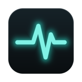
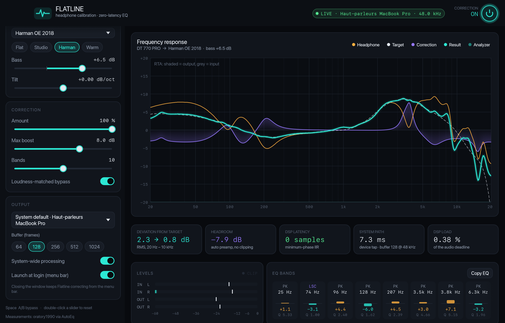

<p align="center">
  
</p>

<h1 align="center">Flatline</h1>

<p align="center">
  <b>System-wide headphone calibration for macOS, with zero added DSP latency.</b><br>
  Your headphones have a sound signature. Flatline flattens it to a reference target,<br>
  for every app at once, in pure Rust.
</p>

<p align="center">
  <a href="https://github.com/WessimH/flatline/actions/workflows/ci.yml"></a>
  <a href="https://wessimh.github.io/flatline/"></a>
  
  
  <a href="LICENSE"></a>
</p>

<p align="center">
  
</p>

---

## Why

Headphone calibration tools like Sonarworks SoundID Reference correct a headphone's frequency response toward a neutral target. Flatline does the same thing, open source and native:

- **System-wide.** Spotify, a browser, a game, a DAW: everything that plays to your headphones is corrected. No virtual driver to install.
- **Zero added DSP latency.** The correction is a cascade of minimum-phase IIR filters. The impulse response starts on sample 0, so there is no look-ahead and no pre-ringing.
- **Measured, not guessed.** The built-in profiles use oratory1990's measurements of the **Beyerdynamic DT 770 PRO** (stock, worn pads, Dekoni Hybrid, PRO X). Drop any frequency-response CSV on the window to calibrate another headphone.
- **Honest A/B.** Press <kbd>Space</kbd> to bypass. The bypass is loudness-matched, so you compare tone, not volume.

## Features

| | |
|---|---|
| **Correction designer** | Fits up to 16 bands (2 shelves + peaks) with greedy seeding and Levenberg–Marquardt refinement. On the DT 770 PRO it cuts the deviation from Harman 2018 from 2.3 dB to 0.76 dB RMS, slightly better than AutoEq's published 10-band EQ (0.85 dB). |
| **Targets** | Harman over-ear 2018, oratory1990 Optimum Hi-Fi; Bass shelf and Tilt controls; Flat / Studio / Harman / Warm presets. |
| **Safety** | Automatic preamp (no clipping), adjustable maximum boost, click-free crossfades when anything changes. |
| **Live view** | Frequency-response graph with hover readout, 1/6-octave real-time analyzer (input vs output), level meters with peak hold, DSP load. |
| **Export** | Copy the EQ in Equalizer APO / AutoEq `ParametricEQ.txt` format. |
| **Lives in the menu bar** | Close the window and Flatline keeps correcting. Optional launch at login, hidden. |
| **Follows your setup** | Follows the system default output, restarts on device or sample-rate changes, buffer from 64 to 1024 frames. |

## Latency

The EQ adds **0 samples**. What remains is the macOS audio path itself (tap → IO callback → device), measured from CoreAudio timestamps at 48 kHz:

| Buffer | System path |
|---:|---:|
| 64 frames | 4.7 ms |
| 128 frames (default) | 7.3 ms |
| 256 frames | 12.7 ms |

DSP load is around 0.3 % of the audio deadline on Apple Silicon.

## How it works

```text
 every app ──► CoreAudio process tap on the headphone output
                (that audio is muted while Flatline reads it)
                        │
          private aggregate device: one IO callback, one clock
                        │
                        ▼
         Processor: minimum-phase biquads in f64 ──► headphones
```

1. **Capture.** A [process tap](https://developer.apple.com/documentation/coreaudio/capturing-system-audio-with-core-audio-taps) (macOS 14.2+) captures what every other process sends to the headphone device, and mutes it while it is being read. If Flatline quits or crashes, audio goes straight to the device again.
2. **One clock.** The tap and the real device are combined in a private aggregate device, so input and output run in the same IO callback with no drift and no resampler. Tapping the device stream instead of the global mix avoids about 40 ms of extra buffering.
3. **Real-time safe.** The callback never allocates, locks or blocks. EQ settings arrive through a wait-free ring buffer ([`rtrb`](https://crates.io/crates/rtrb)); meters and status go back through atomics.
4. **Design off the audio thread.** A worker thread fits the correction whenever a control changes, and the UI sends the coefficients over.

The [API documentation](https://wessimh.github.io/flatline/) walks through every module.

## Install

Requirements: macOS 14.2 or later, Rust 1.89 or later, Xcode command line tools.

```sh
git clone https://github.com/WessimH/flatline
cd flatline
./scripts/bundle.sh          # builds dist/Flatline.app (release, ad-hoc signed, with icon)
open dist/Flatline.app
```

On first launch, macOS asks to let Flatline **record system audio**. Allow it, or enable Flatline under *System Settings → Privacy & Security → Screen & System Audio Recording → System Audio Recording Only*. The app bundle matters: macOS only grants this permission to an app that declares it in its `Info.plist`. Running the bare binary works for the UI, but the capture stays blocked.

> If Flatline shows **BLOCKED** although it is enabled in System Settings, the permission belongs to an older signature: run `tccutil reset All dev.flatline.app` and relaunch.

## Use

- Pick your headphone and a target, adjust **Bass**, **Tilt**, **Amount** and **Max boost**.
- <kbd>Space</kbd> or the power button: A/B against the uncorrected sound.
- Drop a `frequency, dB` CSV (AutoEq, REW, …) on the window to calibrate any headphone.
- Close the window: Flatline stays in the menu bar. **Quit** from the menu-bar icon.

### Command line

```text
flatline --devices         list audio outputs (* = system default)
flatline --print-eq        print the DT 770 PRO correction in Equalizer APO format
flatline --dump-curves     measured / target / EQ / result curves as JSON
flatline --background      start hidden in the menu bar (used by launch at login)
```

## Development

```sh
cargo test --release          # DSP unit tests + doc tests (fit vs AutoEq, zero-latency impulse, …)
cargo clippy --all-targets -- -D warnings
cargo doc --no-deps --open    # the API documentation
```

| Path | |
|---|---|
| `src/dsp/` | Biquads, curves, the correction fitter and the real-time processor. Platform independent. |
| `src/engine/` | CoreAudio: device listing, process tap, aggregate device, IO callback. |
| `src/ui/` | egui interface, graph, widgets, menu-bar icon, procedural app icon. |
| `src/analyzer.rs` | FFT real-time analyzer. |
| `data/` | Headphone measurements and target curves (CSV). |
| `scripts/bundle.sh` | Builds and signs `Flatline.app`. |

Environment knobs for testing: `FL_BUF=64` forces the buffer size, `FL_TAP=global` uses the global-mix tap instead of the device tap, `FL_DEMO=1` starts with factory settings without saving them, `FL_SHOT=out.png` writes a screenshot of the window after `FL_SHOT_SECS` seconds and quits.

## Roadmap

- New interface, art direction "Horizon": living light that follows the music, glass cards, an animated A/B transition.
- AU / VST3 / CLAP plugin version for DAW monitoring.
- More headphone profiles and a profile browser.

## Credits

- Headphone measurements by [oratory1990](https://www.reddit.com/r/oratory1990/), target curves and reference EQs from the [AutoEq](https://github.com/jaakkopasanen/AutoEq) project by Jaakko Pasanen. Measurement data remains the property of its authors; it is included here, with credit, for non-commercial calibration use.
- Filter formulas from Robert Bristow-Johnson's *Audio EQ Cookbook*.
- Harman target research by Sean Olive, Todd Welti and colleagues.

Flatline is an independent project, not affiliated with Sonarworks, Beyerdynamic or Harman. Product names are trademarks of their owners.

## License

[MIT](LICENSE) © 2026 Wessim HARMEL
